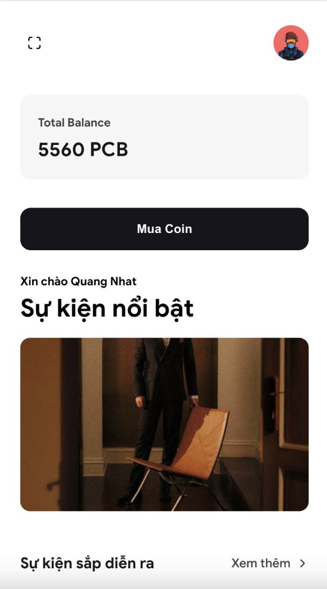
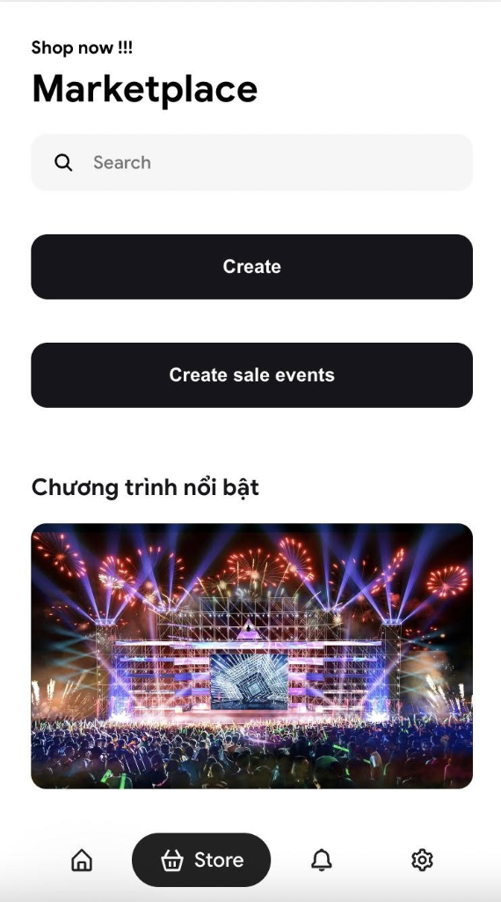
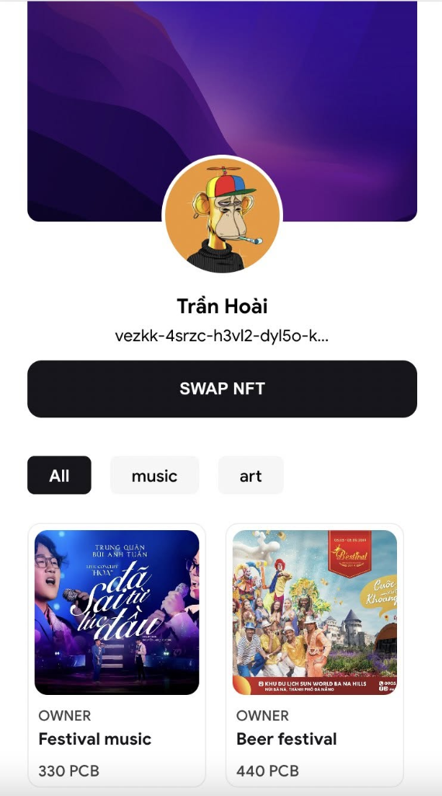
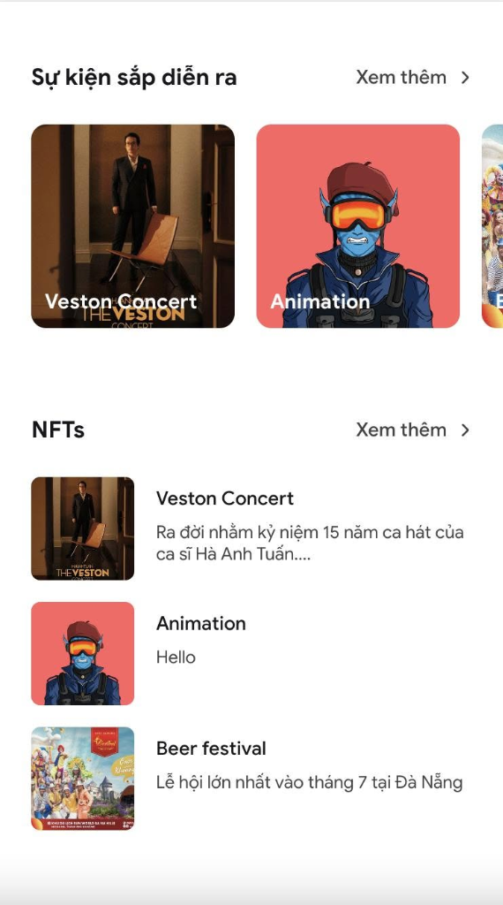
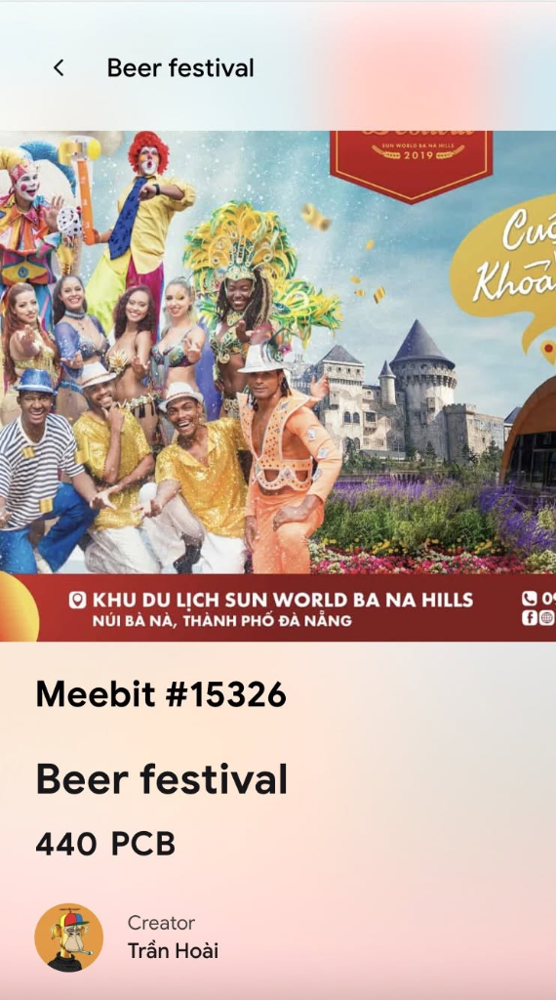
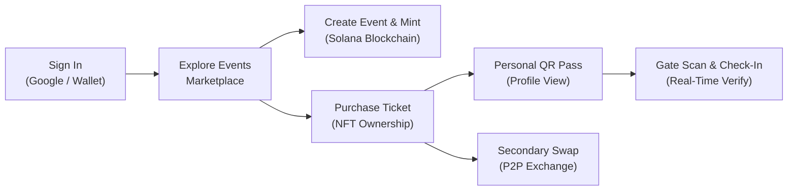

# PassBook — Decentralized Web3 Event Ticketing & NFT Platform

[](https://solana.com/)
[](https://reactjs.org/)
[](https://webpack.js.org/)
[](https://firebase.google.com/)
[](https://www.docker.com/)
[](LICENSE)

> A modern Web3 event ticketing and digital collectible marketplace built on the **Solana** blockchain, combining friction-free Web2 authentication (Google OAuth) with transparent, tamper-proof Web3 digital asset ownership.

<p align="center">
  
  
  
</p>

---

## 📸 Screenshots & Interface Previews

| Discovery & Home | Upcoming Shows & NFTs | Marketplace & Operations |
| :---: | :---: | :---: |
|  |  |  |
| **PassBook Balance & Featured Events** | **Category Filters & Event Catalog** | **Marketplace & Event Creation** |

<br/>

| Ticket & NFT Detail View | Profile Portfolio & NFT Swap |
| :---: | :---: |
|  |  |
| **On-Chain Collectible Details & Pricing** | **Owned Tickets & P2P Swapping** |

---

## 📖 Introduction

**PassBook** is a decentralized application (dApp) designed to revolutionize event ticketing and attendance verification through Solana NFTs and SPL tokens. Traditional ticketing models suffer from widespread counterfeit tickets, extortionate secondary market scalping, non-transparent gate control, and zero post-event utility. 

PassBook eliminates these vulnerabilities by anchoring ticket creation, ownership, and redemption directly on the high-throughput, low-fee **Solana** blockchain. Featuring a hybrid architecture, attendees can seamlessly sign in using their everyday Google accounts or connect premier Solana wallets (Solflare, Phantom, Backpack) to mint, store, trade, and verify authentic event passes.

---

## 🌟 Key Features

- **On-Chain Ticket & NFT Minting**:
  - Organizers create events with custom attributes: event name, date, time, venue, ticket tiers, exclusive gifts, and supply caps.
  - Automatic on-chain minting of SPL tokens and NFTs via `@solana/spl-token` and `@solana/web3.js`.
- **Real-Time QR Code Verification & Gate Check-In**:
  - Built-in camera QR scanner (`react-qr-scanner`) allowing gatekeepers to validate tickets in real-time.
  - One-time ticket redemption logic preventing duplicate gate entries or re-used passes.
- **Decentralized Ticket Marketplace & Swap**:
  - Public marketplace categorized by event genres: Music, Tech, Sports, Movies, and Arts.
  - Peer-to-peer ticket and NFT swapping mechanism directly between users.
- **Community Social Feed**:
  - Dedicated interactive social feed where attendees post event updates, share high-res photos, and engage with other participants.
- **Virtual Event & Live Stream Integration**:
  - Support for live broadcast previews and virtual attendee avatars in live event rooms.
  - Integrated role-based gatekeeper management for event staff.
- **Decentralized Storage & Metadata**:
  - Seamless media and metadata persistence via IPFS (Pinata & Web3.Storage) and Imgur API.

---

## 🛠️ Tech Stack & Architecture

| Layer | Technologies | Role / Purpose |
| :--- | :--- | :--- |
| **Frontend UI** | [React 18](https://reactjs.org/), [Framer Motion](https://www.framer.com/motion/) | Component-based client interface, smooth page transitions |
| **Bundler & Build** | [Webpack 5](https://webpack.js.org/), Babel | Modern JavaScript compiler, Node.js browser polyfills, Sass pipeline |
| **Styling** | [Sass / SCSS](https://sass-lang.com/) | Modular stylesheets, design token system, responsive layouts |
| **Blockchain** | [Solana](https://solana.com/) (Testnet / Devnet / Mainnet) | Ultra-fast L1 blockchain for minting and token transfers |
| **Web3 SDKs** | `@solana/web3.js`, `@solana/spl-token` | Transaction construction, token accounts, authority management |
| **Wallet Layer** | `@solana/wallet-adapter-react`, Solflare SDK | Universal wallet connection (Solflare, Phantom, Backpack) |
| **NFT Standards** | `@metaplex-foundation/js` | Metadata structure and NFT standards |
| **Backend & Sync** | [Firebase Realtime Database](https://firebase.google.com/) | Real-time database for event listings, feeds, and ticket check-ins |
| **Authentication** | [Firebase Auth](https://firebase.google.com/), `@react-oauth/google` | Google OAuth 2.0 authentication for Web2 onboarding |
| **Decentralized Storage** | Pinata IPFS, Web3.Storage, Imgur API | Decentralized storage for NFT assets and event posters |
| **Container & CI/CD** | [Docker](https://www.docker.com/), [Nginx](https://nginx.org/), [Dokploy](https://dokploy.com/) | Multi-stage Docker containerization and automated webhook deployment |

---

## 📁 Project Directory Structure

```text
passbook-2/
├── .github/
│   └── workflows/
│       └── deploy.yml      # GitHub Actions workflow for Dokploy deployment
├── public/                 # Static template assets
│   ├── favicon.ico
│   ├── index.html          # Web3 script injection & HTML template
│   └── manifest.json
├── src/
│   ├── api/                # API layer interfacing Firebase, IPFS, and Solana
│   │   ├── IPFS/           # Image upload utilities (Imgur & IPFS)
│   │   ├── NFT/            # Minting, transfer, check-in, and marketplace logic
│   │   ├── Token/          # PassBook Coin (PCB) token helpers
│   │   └── User/           # Profile and user management
│   ├── assets/             # Typography (GoogleSansPlus) & static SVGs
│   ├── components/         # Reusable UI components (AppBar, Ticket, Card, Modal, etc.)
│   ├── config/             # Environment-driven application configurations
│   ├── context/            # SolanaContext state management
│   ├── hooks/              # Custom React hooks (useGumSDK, usePlug, etc.)
│   ├── navigation/         # React Router v6 routing definitions & NavBar
│   ├── providers/          # SolanaProvider with Solflare and adapter support
│   ├── screens/            # Application views:
│   │   ├── Connect/        # Authentication & wallet connection
│   │   ├── Home/           # Discovery dashboard & category filters
│   │   ├── Product/        # Ticket creation, detail, market, and swap views
│   │   ├── QRScan/         # Real-time QR gate scanner
│   │   ├── Checkin/        # Check-in confirmation screen
│   │   ├── Feed/           # Community social stream
│   │   ├── Profile/        # User portfolio of owned tickets & NFTs
│   │   ├── Permission/     # Staff permission manager
│   │   └── Settings/       # User profile settings
│   ├── styles/             # Global SCSS themes, mixins, variables
│   ├── utils/              # Helper functions (slugifiers, random strings)
│   ├── App.js              # Application root, Firebase initialization, OAuth
│   └── index.js            # React DOM entry point
├── .dockerignore           # Docker build exclusions
├── .env.example            # Environment variables template
├── .gitignore              # Git ignore rules
├── babel.config.json       # Babel transpiler configuration
├── Dockerfile              # Multi-stage production container build
├── nginx.conf              # Production Nginx reverse-proxy & SPA routing
├── package.json            # Project manifest & dependencies
├── webpack.config.js       # Webpack 5 bundle configuration
└── README.md
```

---

## 🚀 Getting Started & Installation

### 1. Prerequisites

- **Node.js**: Version `18.x` or `20.x` (LTS recommended)
- **Package Manager**: `npm` or `yarn`
- **Solana Wallet**: Browser extension such as [Solflare](https://solflare.com/) or [Phantom](https://phantom.app/)

### 2. Install Dependencies

Clone the repository and install packages:

```bash
# Clone the repository
git clone git@github.com:nhatnice/passbook-2.git
cd passbook-2

# Install dependencies (legacy peer deps flag handles peer resolution)
npm install --legacy-peer-deps
```

### 3. Environment Variables Configuration

Copy the example environment configuration:

```bash
cp .env.example .env
```

Populate the `.env` file with your credentials:

```env
# ==============================================================================
# PassBook Environment Variables Configuration
# ==============================================================================

# Firebase Configuration (Authentication & Realtime Database)
REACT_APP_FIREBASE_API_KEY=your_firebase_api_key
REACT_APP_FIREBASE_AUTH_DOMAIN=your_project.firebaseapp.com
REACT_APP_FIREBASE_PROJECT_ID=your_project_id
REACT_APP_FIREBASE_STORAGE_BUCKET=your_project.appspot.com
REACT_APP_FIREBASE_MESSAGING_SENDER_ID=your_messaging_sender_id
REACT_APP_FIREBASE_APP_ID=your_app_id
REACT_APP_FIREBASE_MEASUREMENT_ID=your_measurement_id
REACT_APP_FIREBASE_DATABASE_URL=https://your_project-default-rtdb.firebaseio.com/

# Google OAuth Client ID
REACT_APP_GOOGLE_CLIENT_ID=your_google_oauth_client_id.apps.googleusercontent.com

# Solana Blockchain Configuration
# Options: testnet | devnet | mainnet-beta
REACT_APP_SOLANA_NETWORK=testnet
REACT_APP_SOLANA_RPC_ENDPOINT=http://127.0.0.1:8899
REACT_APP_WALLET_SECRET=

# IPFS & Storage Services
REACT_APP_PINATA_KEY=your_pinata_api_key
REACT_APP_PINATA_SECRET=your_pinata_api_secret
REACT_APP_PINATA_FILE_URL=https://gateway.pinata.cloud/ipfs/
REACT_APP_WEB3_STORAGE_TOKEN=your_web3_storage_token
REACT_APP_IPFS_LINK=https://dweb.link/ipfs/

# Imgur API (for event artwork and feed uploads)
REACT_APP_IMGUR_CLIENT_ID=your_imgur_client_id
```

### 4. Running the Development Server

Start the Webpack development server with hot-reloading:

```bash
npm start
```

The application will be accessible at: [http://localhost:8080](http://localhost:8080).

### 5. Production Build

To compile and optimize the client application for production:

```bash
npm run build
```

Compiled bundles and HTML assets are generated in the `dist/` folder.

---

## 🐳 Docker & Dokploy Deployment

### Run Locally with Docker

```bash
# Build the Docker image
docker build -t passbook:latest .

# Run container on port 80
docker run -d -p 80:80 --name passbook-app passbook:latest
```

### Automated Dokploy Deployment

The repository includes a ready-to-use GitHub Actions workflow at `.github/workflows/deploy.yml`. When changes are pushed to the `main` branch, the workflow triggers Dokploy's automated deployment webhook.

1. In your GitHub repository settings, navigate to **Settings** > **Secrets and variables** > **Actions**.
2. Add a new repository secret:
   - **Name**: `DOKPLOY_DEPLOY_HOOK_URL`
   - **Value**: Your Dokploy application deployment webhook URL.
3. Every push to `main` will automatically trigger a clean container build and zero-downtime deployment.

---

## 🔄 User Workflow & Operations



1. **Sign In**: Authenticate via Google OAuth or connect your preferred Solana wallet.
2. **Discover Events**: Browse upcoming gatherings across Music, Tech, Sports, and Movies.
3. **Issue Passes (Organizers)**: Fill in event parameters on the Create page (`/#/product/create`) to mint verifiable tickets on Solana.
4. **Acquire & Manage Passes**: View your owned digital tickets under Profile (`/#/profile`).
5. **Gate Verification**: Event staff open the QR scanner (`/#/qr`) to scan attendee tickets. The system verifies authenticity against the database and marks check-in status instantly.
6. **Community Interaction**: Share pictures and stories on the community Feed (`/#/feed`).

---

## 🔒 Security Audit & Hardening Notes

The codebase has undergone a comprehensive security audit and sanitization:

- **Decoupled Sensitive Secrets**: Extracted all hardcoded Firebase credentials, Google Client Secrets, Pinata keys, Web3.Storage tokens, and test mnemonic seeds into environment variables.
- **Client Security Compliance**: Completely eradicated exposed OAuth Client Secrets from browser modules.
- **Personal Data Sanitization**: Removed residual developer JWT tokens, personal emails, and debugging test mock accounts.
- **Clean Workspace**: Purged `.DS_Store` binary files and established strict ignore patterns in `.gitignore` and `.dockerignore`.

---

## 👤 Credits & Authorship

- **Author & Lead Developer**: **Quang Nhat (NHΛTTRΛN)**
  - 🌐 **Website**: [nhattran.dev](https://nhattran.dev)
  - 📧 **Email**: [contact@nhattran.dev](mailto:contact@nhattran.dev)
  - 🐙 **GitHub**: [@nhatnice](https://github.com/nhatnice)
- **Development Team**: [Lavensoft / Lavenes](https://github.com/nhatnice)

### Open Source Acknowledgments

- [Solana Labs](https://github.com/solana-labs) — Solana web3 and SPL token development libraries.
- [Metaplex](https://metaplex.com/) — Solana NFT standards and tooling.
- [Firebase](https://firebase.google.com/) — Real-time database and identity infrastructure.
- [Elusiv Privacy](https://github.com/elusiv-privacy) — Foundational privacy transaction architecture.

---

## 📄 License

This project is licensed under the [ISC License](LICENSE). Please preserve author attribution and credit notices in downstream usage.
